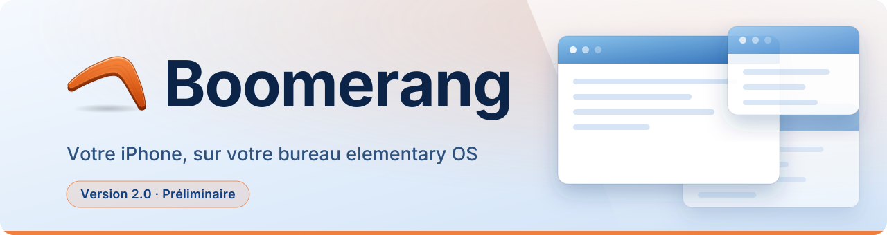
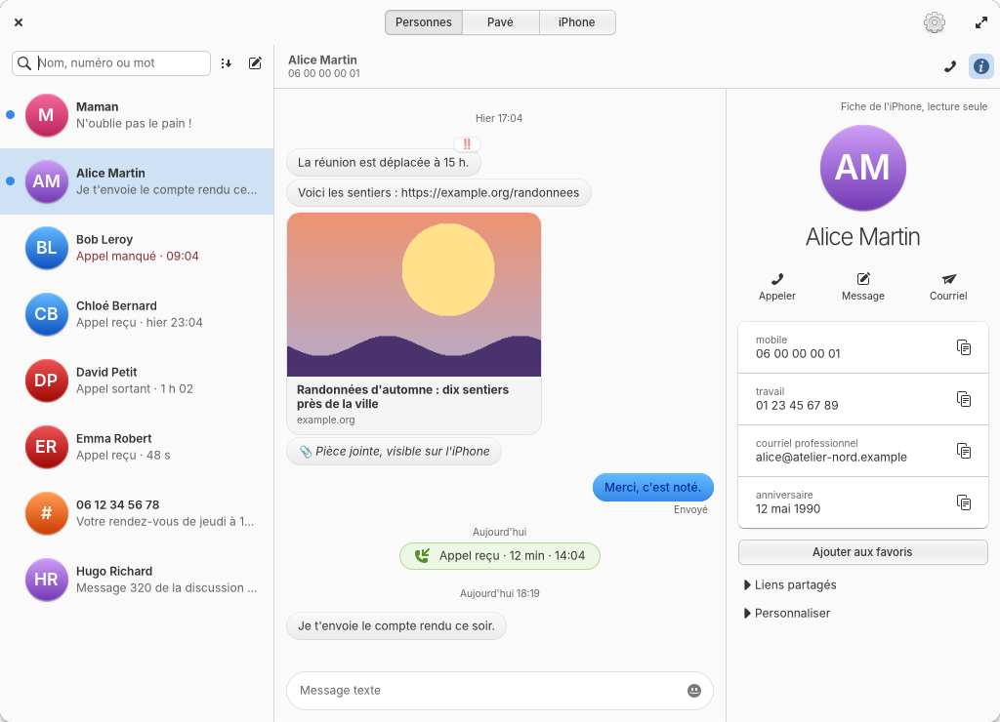
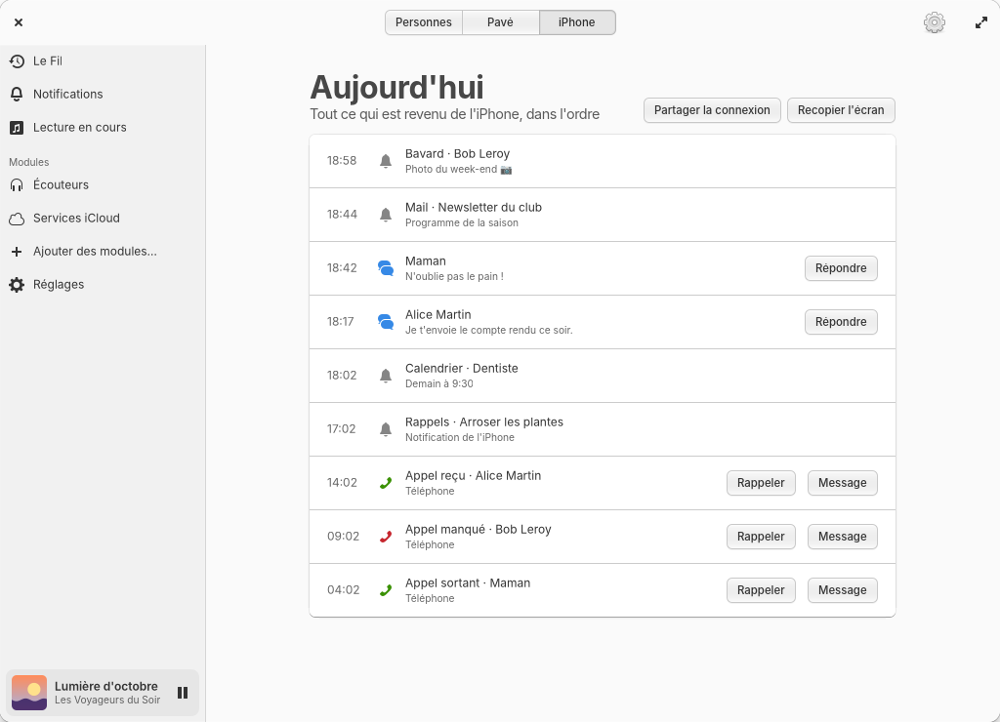
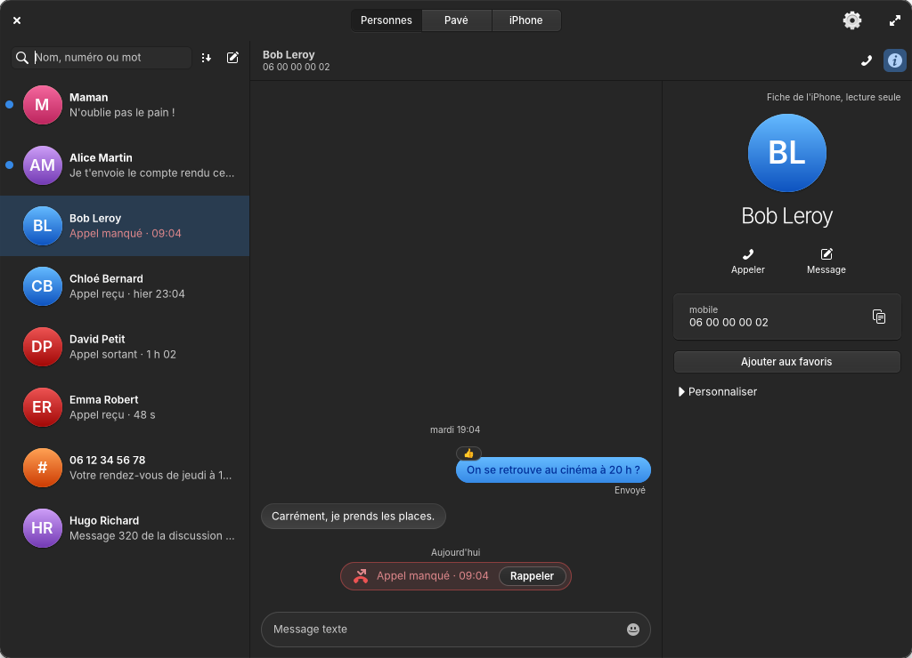
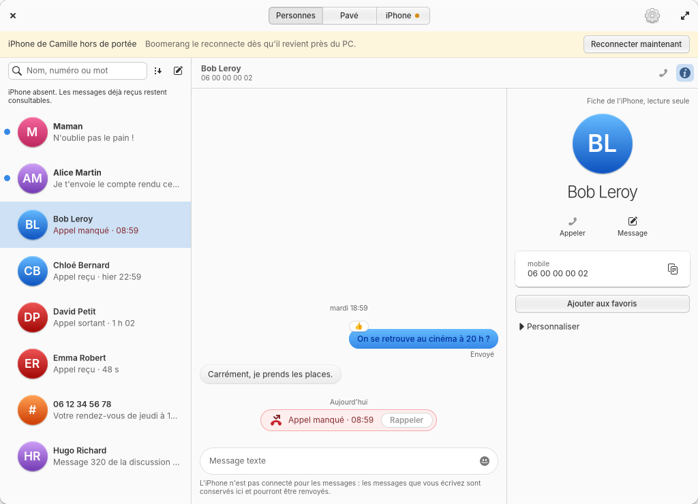
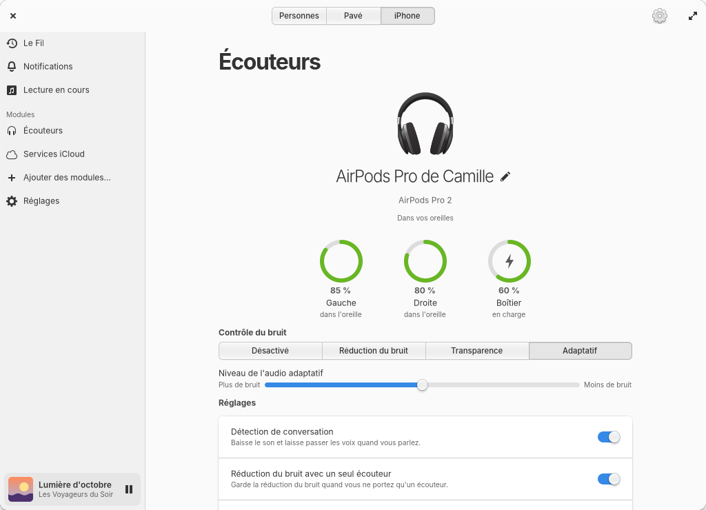
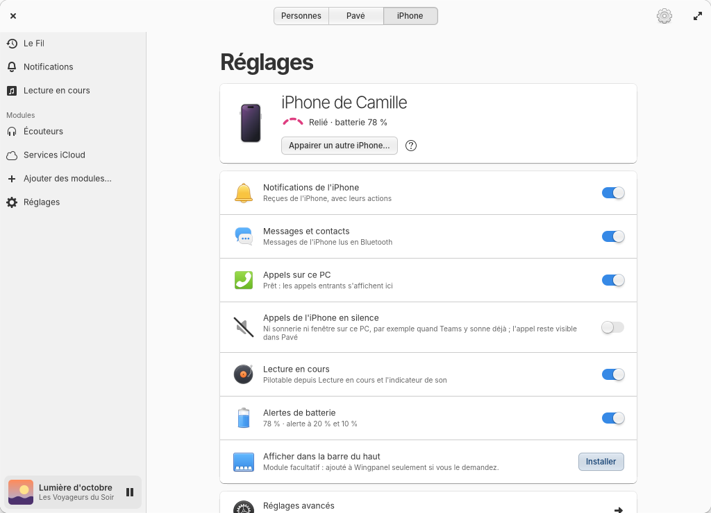

<p align="center">
  <picture>
    <source media="(prefers-color-scheme: dark)" srcset="docs/assets/en-tete-sombre.svg">
    
  </picture>
</p>

<p align="center">
  <a href="#installer">Installer</a> ·
  <a href="#ce-que-ça-change-au-quotidien">Au quotidien</a> ·
  <a href="#le-reste-seulement-si-vous-le-demandez">Modules</a> ·
  <a href="#vie-privée">Vie privée</a> ·
  <a href="#crédits">Crédits</a> ·
  <a href="https://melvin-cwz.github.io/boomerang/fr/">Site</a> ·
  <a href="README.en.md">English</a>
</p>

Vous travaillez sur elementary OS, l'iPhone posé à côté du clavier. Il vibre, vous le prenez,
vous répondez, vous le reposez, et vous cherchez où vous en étiez. Boomerang supprime cet
aller-retour. Les messages, les appels, les notifications et la musique de l'iPhone se lisent
et se pilotent depuis le bureau, dans une application native : les fenêtres, les
notifications, la couleur d'accentuation et le mode sombre sont ceux du système.

<p align="center">
  
  <br>
  <sub>L'onglet Contacts : les messages et les appels d'Alice dans un seul fil, sa fiche à droite.</sub>
</p>

> **Version préliminaire.** Boomerang 2 a toutes ses fonctions et sert chaque jour à son
> auteur. Il lui manque l'épreuve du nombre : d'autres iPhone, d'autres ordinateurs, d'autres
> habitudes que les siennes. Vous rencontrerez peut-être une anomalie. Signalez-la :
> chaque signalement rapproche cette version de la version stable.

*Boomerang s'appelait Covalence jusqu'à la version 0.6. La mise à jour conserve vos réglages,
vos messages et vos comptes iCloud.*

## Une personne, un fil

Personne ne se dit « ouvrons l'application Téléphone, puis l'application Messages ». On pense
à quelqu'un. Boomerang 2 s'organise donc autour des personnes, et non plus autour de trois
applications séparées.

Choisissez Alice : ses messages et ses appels, reçus, passés ou manqués, se suivent dans un
seul fil, dans l'ordre où ils ont eu lieu. Sa fiche se tient à droite. Lui répondre, la
rappeler, copier son numéro : tout part du même endroit, en un ou deux clics.

Trois onglets structurent l'application :

- **Contacts** : la liste de vos échanges, la recherche par nom, par numéro ou par mot, et le
  fil de chacun.
- **Composer** : composer un numéro et passer l'appel avec le micro et les haut-parleurs de
  l'ordinateur.
- **iPhone** : le fil de la journée (tout ce que l'iPhone a reçu, dans l'ordre), les notifications, la lecture en cours,
  les modules et les réglages.

<p align="center">


</p>

## Ce que ça change au quotidien

- **Lire et répondre.** Vos conversations SMS avec tout leur historique, les brouillons, la recherche, les filtres Non lus et Inconnus. Vous répondez par SMS à une personne à la fois. Un message supprimé sur l'iPhone disparaît aussi du bureau.
- **Prendre un appel.** Répondre, refuser, appeler, avec le micro et les haut-parleurs de l'ordinateur. Double appel, choix de la sortie audio en cours d'appel, favoris, messagerie vocale. Demande PipeWire 1.4 ou plus récent.
- **Retrouver quelqu'un.** Les contacts de l'iPhone, en lecture seule, ou ceux d'iCloud, que vous modifiez depuis le bureau : fiche complète, photo, import et export vCard.
- **Voir ce qui arrive.** Les notifications de l'iPhone parmi celles du système, avec leurs actions et l'icône de leur application. Effacée sur l'iPhone, une notification s'efface du bureau ; fermée sur le bureau, elle ne revient pas. Vous choisissez les applications qui ont le droit de vous déranger.
- **Piloter la musique.** Ce que joue l'iPhone, avec sa pochette, sa progression et son volume, dans une page et dans un mini-lecteur toujours à portée.
- **Garder un œil sur la batterie.** Le niveau de l'iPhone dans le panneau, une alerte à 20 % puis à 10 %.

## Une liaison qui se fait oublier

Le meilleur état de connexion est celui qu'on ne regarde pas. Quand l'iPhone est là, Boomerang
ne vous en dit rien : l'en-tête reste vide. Quand il s'éloigne, un point ambré et un bandeau
discret disent ce qui se passe et proposent l'action utile : reconnecter, appairer à nouveau,
ouvrir les réglages Bluetooth. En attendant, vos messages restent consultables, et ce que vous
écrivez est gardé pour le retour de l'iPhone.

<p align="center">

</p>

## Le reste, seulement si vous le demandez

Boomerang garde un cœur court et propose le reste en **modules**. Vous ajoutez un module
depuis l'application ; il installe alors ce dont il a besoin. Vous le retirez ; il s'arrête
entièrement.

| | |
|---|---|
| **Écouteurs** | Batterie de chaque AirPod et du boîtier, contrôle du bruit, détection automatique de l'oreille, réglages des tiges, d'après le protocole documenté par LibrePods. |
| **Services iCloud** | Courriel, agendas, rappels et contacts iCloud dans les applications d'elementary, avec un mot de passe pour app. |
| **iCloud Drive et Photos** | Vos fichiers et vos albums dans Fichiers, grâce à [rclone](https://rclone.org). Lisez l'avertissement ci-dessous. |
| **Recopie de l'écran** | L'écran de l'iPhone dans une fenêtre, avec captures. |
| **Et aussi** | Son de l'iPhone sur l'ordinateur, envoi de fichiers, partage de connexion, verrouillage de proximité, codes à usage unique. |

<p align="center">


</p>

> **À propos d'iCloud Drive et Photos.** rclone se connecte comme le site icloud.com, avec le
> mot de passe de votre compte Apple et la double authentification. Apple ne propose pas cet
> accès officiellement : ses conditions d'utilisation d'iCloud limitent l'accès automatisé et
> l'autorisent à suspendre un compte. Cette fonction demande aussi de désactiver la Protection
> avancée des données, ce qui réduit le chiffrement de bout en bout de vos données iCloud. Le jeton de
> connexion expire environ une fois par mois. Vous utilisez cette fonction à vos risques ;
> Boomerang vous demande d'accepter ces risques avant la connexion.

## Installer

Un seul paquet sert elementary OS 9 et elementary OS 8. Il contient deux variantes de
l'application, l'une compilée avec Granite 9, l'autre avec Granite 7, et lance celle qui
correspond à votre système. Vous n'avez rien à configurer.

1. Téléchargez `boomerang_…_amd64.deb` depuis la page des
   [versions](https://github.com/Melvin-Cwz/boomerang/releases).
2. Dans un terminal, depuis le dossier du téléchargement :
   `sudo apt install ./boomerang_*_amd64.deb`. apt installe aussi ce dont Boomerang dépend.
3. Fermez puis rouvrez votre session, et ouvrez Boomerang. L'assistant vous guide pour
   appairer l'iPhone, puis pour iCloud si vous le souhaitez.

Si un composant manque par la suite, Boomerang le signale et propose de l'installer. Pour
désinstaller : `sudo apt remove boomerang`. Vos données restent dans `~/.local/share/boomerang`
et `~/.config/boomerang` tant que vous ne les supprimez pas
(voir [confidentialité](docs/confidentialite.md)).

| Système | État |
|---|---|
| elementary OS 9 | Le système sur lequel Boomerang est conçu et utilisé chaque jour. |
| elementary OS 8 | Même paquet, variante Granite 7. Elle est compilée et son affichage est vérifié, mais elle n'a pas encore été testée sur une installation réelle d'elementary OS 8 : vos retours sont utiles. L'indicateur du panneau n'est disponible que sous elementary OS 9. |
| Ubuntu 24.04 ou plus récent | Demande Granite 7.7 ou plus récent. Ubuntu 24.04 fournit un rclone trop ancien pour iCloud : Boomerang propose de télécharger la version officielle. |

Les appels demandent PipeWire 1.4 ou plus récent ; à défaut, Boomerang les désactive et dit
pourquoi. Côté matériel, il faut un adaptateur Bluetooth Low Energy, ce qui est le cas de
presque tous les ordinateurs récents.

<details>
<summary>Compiler depuis les sources</summary>

```sh
meson setup build --prefix=$HOME/.local
ninja -C build && meson install -C build
systemctl --user daemon-reload && systemctl --user enable --now boomerangd
```

Dépendances de compilation : `valac`, `meson`, `libgtk-4-dev`, et `libgranite-9-dev` ou
`libgranite-7-dev` (7.7 ou plus récent) ; si les deux sont présentes, les deux variantes sont
compilées. Les dépendances d'exécution sont listées dans `debian/control`. Tests hors ligne :
`meson test -C build`. Paquet : `packaging/build-deb.sh`.

</details>

## Ce que Boomerang ne fait pas

Mieux vaut le savoir avant d'installer. Ces limites tiennent presque toutes à ce qu'un iPhone
accepte d'un ordinateur qui n'est pas un Mac :

- Pas d'envoi d'iMessage, pas de réponse dans les groupes, pas de pièces jointes : en
  Bluetooth, l'iPhone ne laisse partir qu'un SMS, vers une seule personne.
- Pas de presse-papiers universel, de Handoff, d'AirDrop ni de Caméra de continuité.
- Supprimer un message dans Boomerang ne le retire pas de l'iPhone.
- Pas de FaceTime ni de messagerie vocale visuelle.
- L'iPhone ne rouvre pas toujours seul la liaison. Boomerang passe alors par le Bluetooth
  classique ; si les notifications restent interrompues, « Appairer à nouveau » guide la
  réparation
  (voir le [guide](data/guide/fr/12-troubleshooting.md)).
- Déverrouiller l'ordinateur avec l'iPhone est exclu, par choix : la force d'un signal
  Bluetooth se falsifie.

## Vie privée

Rien ne passe par un serveur à nous, parce qu'il n'y en a pas. L'iPhone parle à l'ordinateur en
Bluetooth ; iCloud passe par Internet, entre vous et Apple, sans intermédiaire. Pas de compte
à créer, pas de télémétrie, pas d'application à installer sur l'iPhone.

Les journaux de Boomerang ne contiennent jamais le texte des notifications ou des messages,
ni les noms ni les numéros. Le détail est dans la page [confidentialité](docs/confidentialite.md).

## Aide

Boomerang contient un guide intégré, en français et en anglais (touche F1, ou Guide dans le menu de la fenêtre). Il
explique l'appairage, les réglages à activer sur l'iPhone, iCloud, les AirPods et le
dépannage. Questions et signalements :
[Issues](https://github.com/Melvin-Cwz/boomerang/issues).

## Auteur

Je ne suis pas développeur. Je suis un passionné d'elementary OS, utilisateur d'iPhone, avec
quelques idées, et je construis Boomerang en « vibe coding » avec Claude, l'assistant
d'Anthropic : je décris ce que je veux, je teste chaque jour sur mon propre ordinateur, et
nous corrigeons ensemble. Le code est ouvert pour que les personnes qui s'y connaissent mieux
puissent le lire, signaler les erreurs et aider. Contributions, signalements et conseils
bienveillants sont les bienvenus.

MelvinCwz

## Fonctionnement

- **boomerangd**, le service (Python, PyGObject) : il maintient la liaison Bluetooth et
  conserve les secrets. Il communique avec l'iPhone par BlueZ (ANCS et AMS en Bluetooth LE, MAP et PBAP par obexd,
  HFP par `org.pipewire.Telephony` de PipeWire), à iCloud par Evolution Data Server et
  libsecret, et lance rclone pour Drive et Photos.
- **L'application** (Vala, GTK 4, Granite) : une seule fenêtre, organisée par personne, plus
  Écouteurs et Recopie qui s'ouvrent dans la leur. Elle communique avec le service par D-Bus
  (`io.github.melvincouwez.Boomerang.Daemon`). Le paquet en contient deux variantes, compilées
  avec Granite 9 et avec Granite 7 ; au lancement, Boomerang exécute celle qui correspond au
  système.
- Les journaux ne contiennent jamais le texte des notifications ou des messages, ni les noms ni
  les numéros.

## Crédits

Boomerang repose sur le travail de nombreux logiciels libres. La page **Contributeurs** de l'application, dans le menu, les présente tous avec leurs auteurs, leurs licences et leurs liens :

| Projet | Sert à | Licence |
|---|---|---|
| [rclone](https://github.com/rclone/rclone) (Nick Craig-Wood et contributeurs) | iCloud Drive et Photos | MIT |
| [LibrePods](https://github.com/librepods-org/librepods) (Kavish Devar et contributeurs) | Protocole des AirPods et gestes de tête, portés en Python dans `boomerangd/headphones.py` | GPL-3.0-or-later |
| [BlueZ](https://github.com/bluez/bluez) et obexd | Bluetooth, messages et contacts | GPL-2.0-or-later (bibliothèques LGPL-2.1-or-later) |
| [PipeWire](https://gitlab.freedesktop.org/pipewire/pipewire) et [WirePlumber](https://gitlab.freedesktop.org/pipewire/wireplumber) | Appels et son de l'iPhone | MIT |
| [Evolution Data Server](https://gitlab.gnome.org/GNOME/evolution-data-server) | Comptes iCloud | LGPL |
| [libsecret](https://gitlab.gnome.org/GNOME/libsecret) | Mots de passe dans le trousseau | LGPL-2.1-or-later |
| [GTK](https://gitlab.gnome.org/GNOME/gtk), [Granite](https://github.com/elementary/granite), [Vala](https://gitlab.gnome.org/GNOME/vala), [PyGObject](https://gitlab.gnome.org/GNOME/pygobject) | L'application et le service | LGPL (Granite : LGPL-3.0-or-later) |
| [LocalSend](https://github.com/localsend/protocol) | Fichiers avec l'iPhone, protocole v2 | protocole public |
| [UxPlay](https://github.com/FDH2/UxPlay) | Recopie de l'écran, son enregistrement et sa balise Bluetooth (lancé par Boomerang, facultatif) | GPL-3.0 |
| [libimobiledevice](https://github.com/libimobiledevice/libimobiledevice) et [ifuse](https://github.com/libimobiledevice/ifuse) | Import des photos par câble USB (facultatif) | LGPL-2.1-or-later |
| [libheif](https://github.com/strukturag/libheif) | Photos HEIC converties en JPEG (facultatif) | LGPL-3.0 |
| [Icônes elementary](https://github.com/elementary/icons) | Objets à partir desquels les icônes de Boomerang sont dessinées | GPL-3.0 |
| [Twemoji](https://github.com/jdecked/twemoji) (Twitter/X et contributeurs) | Forme du boomerang de l'icône de l'application, adaptée (épaissie, redessinée, recolorée) ; voir `data/icons/NOTICE-icone-application.md` | CC-BY 4.0 |
| [Inter](https://github.com/rsms/inter) (Rasmus Andersson) | Texte de l'icône Calendrier, en contours | SIL OFL 1.1 |
| Android Open Source Project et [Kenney](https://kenney.nl/assets/interface-sounds) | Sons des notifications (détail dans [docs/credits-sons.md](docs/credits-sons.md)) | Apache-2.0 / CC0 |

Boomerang installe deux applications compagnes depuis la page Services Apple, chacune publiée
dans son propre dépôt avec ses versions : **Agenda**
([code source et téléchargements](https://github.com/Melvin-Cwz/agenda), GPL-3.0-or-later) et **Cassette**,
un client Apple Music issu de [Sidra](https://github.com/wimpysworld/sidra), de Martin Wimpress,
et construit sur [CastLabs Electron](https://github.com/castlabs/electron-releases)
([code source et téléchargements](https://github.com/Melvin-Cwz/cassette), Blue Oak Model License 1.0.0).

Un merci particulier à l'équipe de LibrePods pour son remarquable travail de rétro-ingénierie,
et à [nRF Connect](https://www.nordicsemi.com/Products/Development-tools/nRF-Connect-for-mobile)
(Nordic Semiconductor), une app iPhone gratuite qui a servi aux premiers appairages et peut encore servir au besoin.

## Licence et indépendance

Boomerang est un logiciel libre sous [licence GNU GPL version 3 ou ultérieure](LICENSE). Il est
fourni sans aucune garantie.

Boomerang est un projet indépendant. Il n'est ni affilié à Apple Inc. ou à elementary, Inc., ni
approuvé, sponsorisé ou soutenu par eux. Apple, iPhone, iCloud, iMessage, AirPods, AirPlay et
Apple Music sont des marques d'Apple Inc., déposées aux États-Unis et dans d'autres pays et
régions. Ces noms sont cités uniquement pour indiquer les produits et services avec lesquels Boomerang
fonctionne.

Boomerang utilise des protocoles publiés (Bluetooth HFP, MAP, PBAP ; ANCS et AMS, spécifiés par
Apple ; CalDAV, CardDAV, IMAP). Deux fonctions reposent sur des interfaces non documentées : les
AirPods (protocole AAP décrit par LibrePods) et iCloud Drive et Photos (via rclone). Elles
peuvent cesser de fonctionner sans préavis. Boomerang n'a décompilé aucun logiciel Apple.

- Confidentialité : [français](docs/confidentialite.md) · [English](docs/privacy.md). Pas de
  télémétrie, pas de compte, pas de serveur.
- Mentions légales : [docs/mentions-legales.md](docs/mentions-legales.md).
